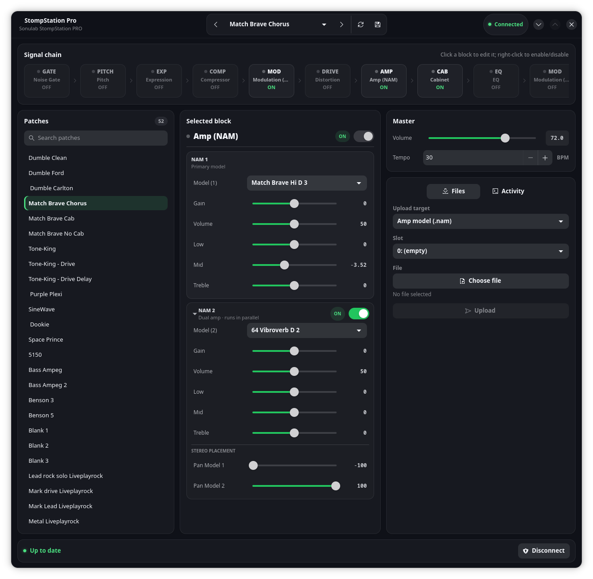

# StompStation Legacy Python Client

The original unofficial Linux client for the **Sonulab StompStation PRO**
guitar multi-effects pedal. It connects over USB or the network and gives you
a GTK4 desktop UI for:

- changing patches,
- enabling/disabling and editing the blocks in the signal chain,
- changing drive/amp models and cabinet IRs,
- uploading NAM and parametric NAM (`.pnam`) amp/drive models and IR WAV files.

The primary application is now the Rust + Tauri desktop app in the repository
root; this Python client is preserved as the protocol reference and fallback.
It is built from the reverse-engineered VoidX node protocol — not from an
official SDK — so use it at your own risk. Tested against firmware **2.4.4**
and **2.5.3**.



## Install

This is a Linux desktop application. You do not need to be a programmer;
copy and paste the commands below.

### 1. Install the required packages

**Debian / Ubuntu**

```bash
sudo apt update
sudo apt install git python3 python3-gi gir1.2-gtk-4.0 gir1.2-adw-1 python3-serial
```

**Arch / CachyOS**

```bash
sudo pacman -S --needed git python-gobject gtk4 libadwaita python-pyserial
```

On other distributions, install Python 3.10+, GTK 4, libadwaita, PyGObject,
and `pyserial` using your package manager.

### 2. Download the app

```bash
git clone https://github.com/obiwanconobi/ssp-linux-controller.git
cd ssp-linux-controller/Legacy
```

You can also download the repository as a ZIP from GitHub, extract it, and
open a terminal in its `Legacy/` folder.

### 3. Connect the pedal

- **Network (default):** connect the pedal and computer to the same Wi-Fi or
  local network.
- **USB:** connect the pedal with a data-capable USB cable. If USB does not
  appear, allow your user to access the serial port:
  - Debian / Ubuntu: `sudo usermod -aG dialout "$USER"`
  - Arch / CachyOS: `sudo usermod -aG uucp "$USER"`

  Log out and back in after changing the group.

Close any other app already connected to the pedal before starting this one if
you are on USB. Firmware 2.5.3 allows several Wi-Fi readers, but writes are not
coordinated between clients.

### 4. Start the app

```bash
python3 stomp.py
```

In the bottom-right corner, select your pedal and click **Connect**. Network
discovery is selected by default. If the pedal is not discovered, choose
**Manual TCP** and enter its address (for example `192.168.1.97:8080`), or run
`python3 stomp.py --diagnose` for USB diagnostics.

## Features

- **USB serial or network** connection:
  - auto-detected CDC-ACM serial ports (`/dev/ttyACM*`),
  - TCP devices discovered with mDNS (`_http._tcp`, `id` containing `voidx`),
  - manual `host:port` entry.
- Reads the full node tree with `browse root`, then polls `read root` deltas.
- Discovers the patch list, current patch, signal-chain router, block states,
  master volume, and tempo from the device.
- **Signal chain as a horizontal row of colour-coded blocks** — bypassed
  blocks are dimmed; click a block to select and edit it, or right-click it
  to enable/disable it. Empty slot cards add a block; blocks can be dragged
  (or moved with the editor arrows) to reorder them. Amp, Delay, and Reverb
  are fixed in place by the device and cannot be moved or removed.
- **Series/Parallel link selector** between adjacent blocks: click the link
  arrow between two cards. A parallel link feeds both blocks from the same
  input and sums their outputs, matching the pedal's link menu. The controls
  can be hidden from **Device Setup → Interface**.
- Selected-block editor: enable switch plus editable parameters (floats as
  sliders, enums and model/IR lists as dropdowns, numbers as spin buttons,
  text as entries). Nested folders are shown as collapsible sections
  (Tone and Character, Modulation, Pitch, Dual Delay, EQ bands, etc.), and
  time/rate controls offer tempo-synced subdivisions or a manual ms/Hz value.
- **Dual-NAM Amp editing** on firmware 2.0.8+: separate NAM 1 and NAM 2 cards,
  independent model and tone controls, stereo pan per model, and a collapsible
  second-model section.
- **Parametric NAM (`.pnam`) Drive/Amp models**: choose between standard NAM and
  Parametric NAM, then edit the controls the loaded model actually exposes.
  Parameter names, ranges and visibility come from the device's model metadata,
  so hidden legacy tone controls are not shown for parametric models.
  Firmware 2.5.3 switch parameters (for example **Gain-Boost**) are shown as
  discrete ON/OFF controls rather than a 0–1 slider.
- **Dual IR editing**: separate IR 1 and IR 2 cards, independent filter and
  blend controls, per-IR level and pan, and a collapsible second-IR section.
- Patch list with single-click loading, rename, previous/next, reload, and
  save, plus **Save As**.
- **Preset panel**: per-patch level, LED colour, preset tempo with **Tap
  Tempo**, and chain utilities to clear the chain or load its default.
- Master volume and global tempo controls.
- **Live tuner window** with note/cents display, A4 reference, input level and
  tuner enable, plus **VU meters** for both inputs and outputs.
- **Device Setup window**: input 1/2 digital gain and connection state,
  expression-pedal toe/heel calibration, MIDI channel, encoder direction,
  headphone mode, ground lift, USB audio mode/volume, device alias and a
  confirmed factory reset.
- **Global parametric EQ** in its own tab beside Files/Activity: a live
  frequency-response preview with band selector and an **Expand** button for a
  full editor with a draggable 4-band graph, numeric controls for gain,
  frequency, Q, and filter type, and a global enable switch. It applies
  globally to every patch and output.
- NAM, Parametric NAM (`.pnam`) and IR upload with slot selection, overwrite
  confirmation, and progress.
- Activity log.
- Detects patch/chain changes made on the device itself and re-syncs; the
  selected block's parameters, model, and IR also live-update from the device.

Two interfaces are included:

- `stomp_ui.py` — the modern GTK4/libadwaita interface (default).
- `stomp_ui_legacy.py` — the earlier, simpler interface, kept for debugging.

## Advanced running options

Preselect a transport:

```bash
python3 stomp.py --serial /dev/ttyACM0
python3 stomp.py --tcp 192.168.1.97:8080
python3 stomp.py --legacy        # launch the legacy/debug UI
python3 stomp.py --diagnose      # print USB/kernel diagnosis without the UI
```

The UI defaults to network (mDNS) discovery; use the transport dropdown in
the bottom-right corner to switch to USB serial or a manual TCP address.

## Tests

```bash
python3 -m unittest discover -s tests -v
```

The tests use an in-memory fake device and cover protocol parsing,
preset/router discovery, block-parameter extraction, and NAM/IR upload
framing.

## Primary Tauri desktop app

The main application now lives in the repository root. It uses the same
protocol and keeps this Python client as the reference implementation. The
user-facing overview and download links are in the [root README](../README.md);
build, test, and architecture notes are in the
[development guide](../docs/DEVELOPMENT.md). Android notes are in
[`../docs/ANDROID.md`](../docs/ANDROID.md), and hardware validation is in
[`../docs/HARDWARE_VALIDATION.md`](../docs/HARDWARE_VALIDATION.md).

## Repository layout

```
stomp.py               Protocol client / library + entry point
stomp_ui.py            Modern GTK4/libadwaita UI
stomp_ui_legacy.py     Legacy GTK4 UI (debugging backup)
tests/                 Unit tests
docs/
  PROTOCOL.md          Older USB-capture protocol notes
  stompstation-pro-protocol.md  Static reverse-engineering notes (VoidX node protocol)
  FIRMWARE_MODIFICATION.md      Firmware extraction notes
  PROJECT_SUMMARY.md   Development summary / status
  screenshot.png       UI screenshot
  tauri-rebuild-report.html     Tauri rebuild design dossier
../docs/FIRMWARE_2.5.3.md       Firmware 2.5.3 verification (shared)
../dev/                Reverse-engineering artifacts (captures, logs, firmware,
                       sample NAM/IR, the Frida sniff script) — gitignored
```

## Protocol summary

Commands are line-oriented text terminated with `\r\n\0`:

```text
read root                      # poll (delta)
browse root                    # full node-tree snapshot
write <path>:{"value":<v>}     # set a value
write <block>\on_off:{"value":"ON"|"OFF"}
write <preset>:{"value":"Name","save":"save"}   # order is significant
dwrite <list>:{"index":N,"chunk":M,"value":"<hex>"}   # chunked upload
```

A patch is the `value` of the `preset` node; its `ref` points at the patch
list. The signal chain is a `router` node whose non-empty cells are block
paths; router writes must wrap the matrix as `{"value":[[...]]}`. On save, the
firmware applies fields in order: `value` selects the target preset, then
`save` persists the live state. Reversing them reloads the stored preset and
discards unsaved edits. See `docs/stompstation-pro-protocol.md` for details.

## Source of truth

This directory is the original reference material for the protocol and the
Tauri port:

- Python protocol: `Legacy/stomp.py`
- Python UI behaviour inventory: `Legacy/stomp_ui.py`,
  `Legacy/stomp_ui_legacy.py`
- Tests to mirror: `Legacy/tests/test_stomp.py`
- Protocol notes: `Legacy/docs/stompstation-pro-protocol.md`
- Design dossier: `Legacy/docs/tauri-rebuild-report.html`

Nothing in the desktop app requires Python at runtime. The Python client is
kept as a reference implementation and a fallback during the port.

## Known limitations

- Password/token authentication is not implemented (the proprietary hash is
  not documented).
- Chain editing follows the device's fixed positions: Amp, Delay, and Reverb
  cannot be moved or removed.
- Patch import/export bundles are not implemented.
- IR conversion uses the first channel and first 2048 samples, with no
  resampling (matching the official app's observed behaviour).
- The firmware 2.5.3 network server accepts several simultaneous sessions, so
  the Python and Tauri clients can both stay connected over Wi-Fi; earlier
  firmware shares one `read root` delta queue between clients. USB serial
  still exposes a single client. Close the official app before connecting this
  one.

## Disclaimer

This project is not affiliated with or endorsed by Sonulab. It is the result
of independent reverse engineering of the pedal's network/serial protocol.
