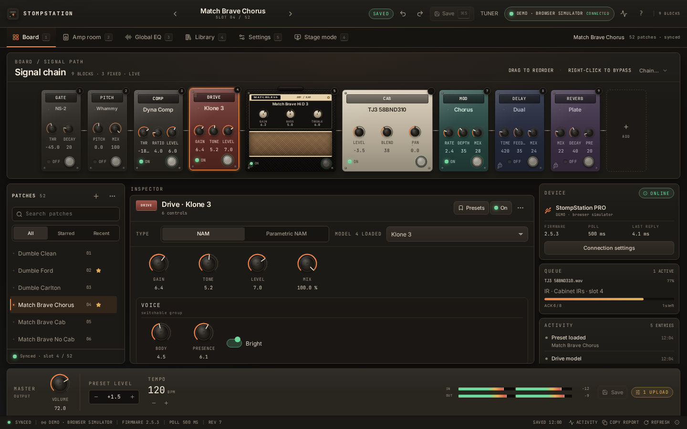
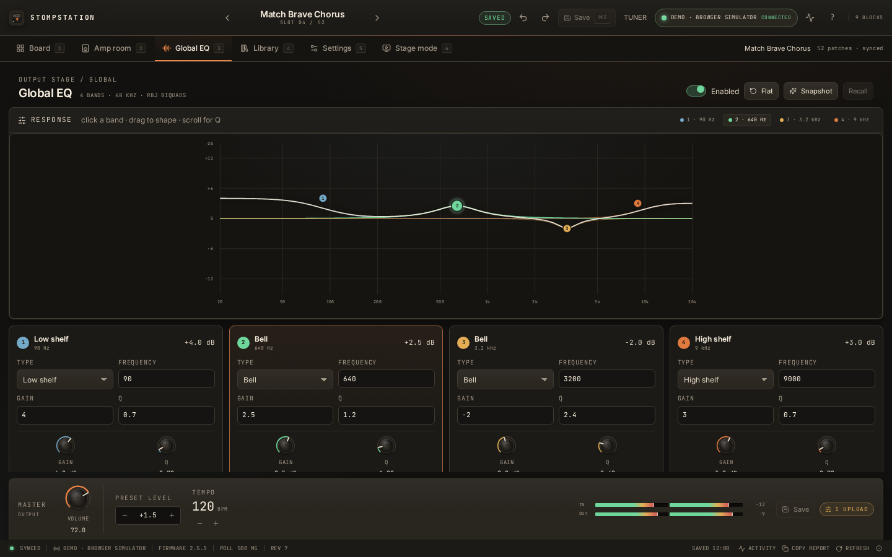
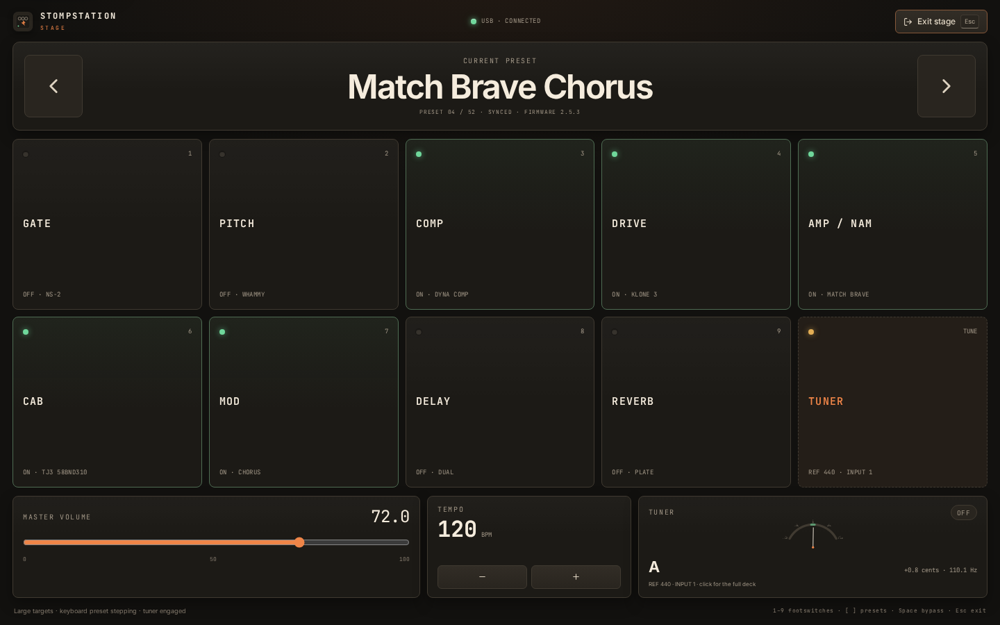
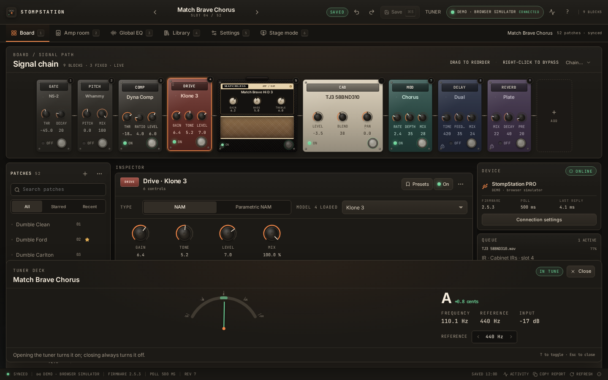
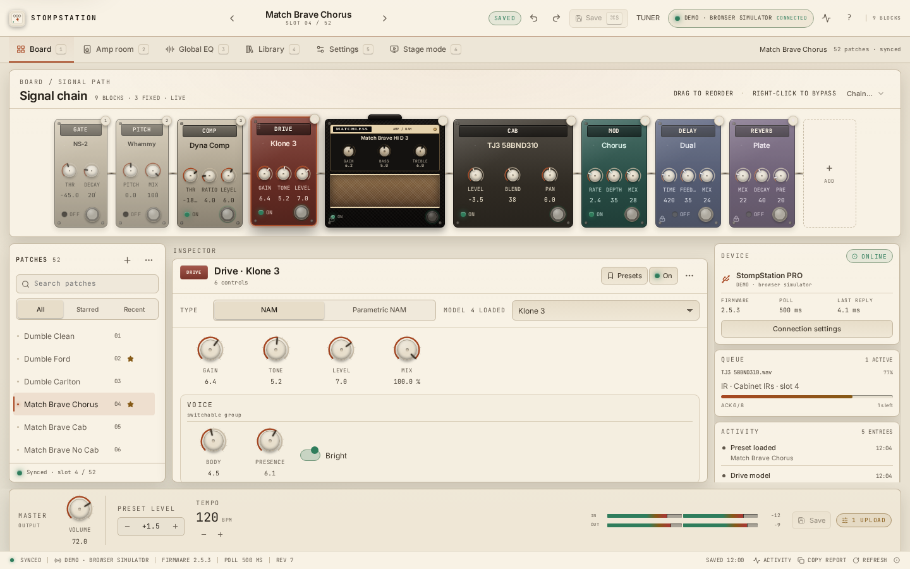

# StompStation

> **Disclaimer:** This is an independent, open-source project. It is not
> affiliated with, endorsed by, or supported by Sonulab. The software may
> contain bugs and is provided “as is”; use it at your own risk, particularly
> when writing to hardware. Review [`docs/DEVICE_SAFETY.md`](docs/DEVICE_SAFETY.md)
> before use.

Pedalboard-first controller for the **Sonulab StompStation PRO** guitar
multi-effects pedal, built with Rust, Tauri, React, and TypeScript. It connects
over Wi-Fi or USB, edits the signal chain and block parameters live, uploads
NAM, Parametric NAM (`.pnam`), IR, and legacy VXAMP files, and keeps a live view
of the pedal. The same Rust core and React UI also build as an Android app.

The original Python GTK client is preserved in [`Legacy/`](Legacy/README.md) as
the protocol reference and fallback.

## Features

- **Live pedalboard.** Connect over Wi-Fi with mDNS discovery, over USB serial,
  or with a manual `host:port`; parameter and router edits reach the pedal
  immediately.
- **Full chain editing.** Add, remove, replace, move, and link blocks, toggle
  bypass, and clear the chain. Fixed amp/delay/reverb slots stay protected.
- **Amp room and tone tools.** Dual NAM lanes, standard and Parametric NAM
  models, dual IRs, Global EQ and in-chain parametric EQ, tuner, tempo/tap, and
  preset level.
- **Presets and captures.** Browse and save presets, rename and delete captures,
  export/import preset bundles, and manage NAM A1/A2, PNAM, IR, and VXAMP
  libraries with preflight validation before every upload.
- **Performance views.** Stage mode, tuner deck, pinned master strip, command
  palette, and keyboard shortcuts for playing rather than clicking.
- **Desktop and Android.** Windows, Linux, and macOS, plus an arm64 Android app
  over Wi-Fi/TCP with responsive phone and tablet layouts.
- **Safety-first writes.** Preflight checks, read-back verification, and
  destructive-action confirmations; a deterministic simulator and demo mode let
  you explore every surface without hardware.
- **Accessible and themeable.** Studio Black, Cream Tolex, and British Green
  themes; WCAG AA scans, keyboard paths for every pointer gesture, and reduced
  motion support.

## Screenshots

Captured at 1440 × 900. Demo surfaces use the deterministic simulator;
screenshots labelled “hardware” use the real 2.4.4 fixture. See the
[full gallery](docs/SCREENSHOTS.md) for every surface.

| | |
| --- | --- |
|  |  |
| **Board** — preset rail, full-width chain, focused inspector, pinned master. | **Amp room** — dual NAM lanes, cabinet, EQ preview, A/B compare. |
|  |  |
| **Global EQ** — direct-manipulation curve + four numeric band cards. | **Library** — models, IRs, preflight, and the visible upload queue. |
|  |  |
| **Stage mode** — glanceable preset, bypass tiles, master, tempo, tuner. | **Tuner deck** — note, cents, frequency, reference, input level. |
|  |  |
| **Cream Tolex** — the same layout, a different finish. | **Real 2.4.4 hardware** — 12 blocks, 60 patch slots, 36 named patches. |

## Download and install

**Latest release:** [github.com/obiwanconobi/ssp-linux-controller/releases/latest](https://github.com/obiwanconobi/ssp-linux-controller/releases/latest)

### Desktop

| Platform | Packages |
| --- | --- |
| Windows x64 | NSIS installer (`.exe`) and MSI (`.msi`) |
| Linux x64 | Debian package (`.deb`) and AppImage |
| macOS x64 (Intel) | `.dmg` and zipped `.app` |
| macOS arm64 (Apple Silicon) | `.dmg` and zipped `.app` |

The Linux AppImage is larger than the Windows bundle because it embeds
GTK/WebKitGTK. macOS builds are ad-hoc signed but not notarized, so Gatekeeper
requires right-clicking the app and choosing **Open** (or removing the
quarantine attribute) on first launch.

### Android

The Android app requires Android 7.0+ on an arm64 device. It is **Wi-Fi/TCP
only** — Android has no usable USB CDC-ACM path here — and shares the same UI
and Rust core as the desktop app.

- **Direct APK:** download `StompStation_<version>_arm64-v8a.apk` from the
  [latest release](https://github.com/obiwanconobi/ssp-linux-controller/releases/latest).
- **Obtainium:** install [Obtainium](https://github.com/ImranR98/Obtainium),
  choose **Add App**, and paste
  `https://github.com/obiwanconobi/ssp-linux-controller`. Obtainium reads the
  GitHub releases and offers each new version as an update.
- **Upgrading from a local build:** if you previously sideloaded a locally
  built, debug-signed APK, uninstall it once before installing the release
  build. Android cannot update across different signing keys.
- Physical-phone validation is still in progress; the emulator suite covers the
  main Android flows.

### Build from source

See the [development guide](docs/DEVELOPMENT.md#install-locally) for desktop
build and local-install instructions, and [`docs/ANDROID.md`](docs/ANDROID.md)
for the Android toolchain and signing setup.

## Quick start

1. Connect the pedal and your computer or phone to the same Wi-Fi network. On
   desktop you can connect the pedal over USB instead; the Android app is
   Wi-Fi/TCP only.
2. Launch StompStation. On desktop it scans mDNS for a VoidX device first and
   then probes USB serial ports; on Android it scans the network. If nothing is
   found, the connection sheet opens.
3. Choose the discovered device, pick the USB port (desktop), or enter a manual
   `host:port` (the pedal's normal TCP service uses port `8080`).
4. Edits apply to the pedal live. **Save** persists the live chain and
   parameters into the current preset; it stays disabled until something is
   dirty.

To try the app without hardware, launch it with `--demo` (or
`STOMPSTATION_DEMO=1`) to use the in-process simulator. In the browser preview,
`Ctrl/⌘+K` opens the command palette, `1`–`6` switch views, `T` opens the
tuner, and `Space` bypasses the selected block.

## Hardware safety

Device writes are real. Before writing to hardware or running a hardware upload
test, read [`docs/DEVICE_SAFETY.md`](docs/DEVICE_SAFETY.md). It records the
2026-11-22 soft-brick caused by a synthetic NAM upload, the format and list
invariants that prevent a repeat, and the recovery playbook for update mode. Use
scratch slots for upload testing and keep the pedal's update path available.

## Troubleshooting

- **No device found on launch.** Check that the pedal and computer are on the
  same network, or open the connection sheet and pick the USB port.
  `/dev/ttyACM0` needs the udev rule in
  `packaging/linux/70-stompstation.rules` if access is denied.
- **Wi-Fi connects but commands time out.** Close other clients before
  reconnecting on older firmware; firmware 2.5.3 allows several network readers,
  but writes are not coordinated between clients.
- **Save is disabled.** It enables only when the preset is dirty. A board
  refresh does not clear the dirty flag.
- **Parametric NAM looks empty.** A PNAM block needs an active `pmodel`;
  changing the model rebrowses the editor so its controls appear.
- **Android finds nothing.** Vendor Wi-Fi stacks sometimes block multicast even
  with a MulticastLock. Enter the pedal's IP manually.

More troubleshooting and simulator instructions are in the
[development guide](docs/DEVELOPMENT.md#troubleshooting).

## Documentation

| Guide | Contents |
| --- | --- |
| [Development guide](docs/DEVELOPMENT.md) | Architecture, project status, build, tests, simulator, release pipeline |
| [Screenshots](docs/SCREENSHOTS.md) | Full gallery of interface and hardware surfaces |
| [Android](docs/ANDROID.md) | Android build, install, signing, local-network notes |
| [Android UI testing](docs/ANDROID_UI_TESTING.md) | Appium/CDP harness, selectors, extension recipes |
| [Device safety](docs/DEVICE_SAFETY.md) | Read before any hardware write; recovery playbook |
| [Hardware validation](docs/HARDWARE_VALIDATION.md) | Differential results and the hardware checklist |
| [Remaining validation](docs/REMAINING_VALIDATION.md) | The step-by-step remaining hardware pass |
| [Firmware 2.5.3](docs/FIRMWARE_2.5.3.md) | Firmware verification and client-side changes |
| [Legacy Python client](Legacy/README.md) | Original GTK client, protocol reference, and tests |
| [Third-party notices](NOTICE.md) | Dependency licenses and privacy notes |

## Project status

StompStation is in active development. Core flows — gate writes, preset save,
chain editing, Wi-Fi discovery, Parametric NAM editing, and basic NAM
A2/PNAM/IR/VXAMP uploads — have been exercised on firmware 2.4.4 and 2.5.3.
Chain move/link, EQ writes, upload cancel/overwrite paths, physical-phone
Android validation, and long idle polling remain open. The detailed status
matrix, hardware results, and known gaps are in the
[development guide](docs/DEVELOPMENT.md#project-status).

## Legacy Python client

The original GTK4/libadwaita client remains available under [`Legacy/`](Legacy/README.md)
as the protocol reference and a fallback during the port. Nothing in the Tauri
app requires Python at runtime.

## Contributing

Issues and pull requests are welcome. Start with the
[development guide](docs/DEVELOPMENT.md), and run the hardware-free test matrix
before opening a PR. Never run new writes against hardware without reading
[`docs/DEVICE_SAFETY.md`](docs/DEVICE_SAFETY.md) first.

## License

StompStation is MIT licensed. Third-party dependency licenses and privacy notes
are listed in [`NOTICE.md`](NOTICE.md).
