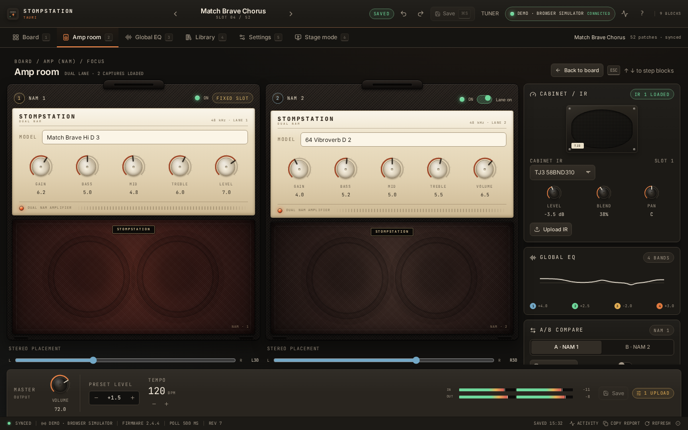
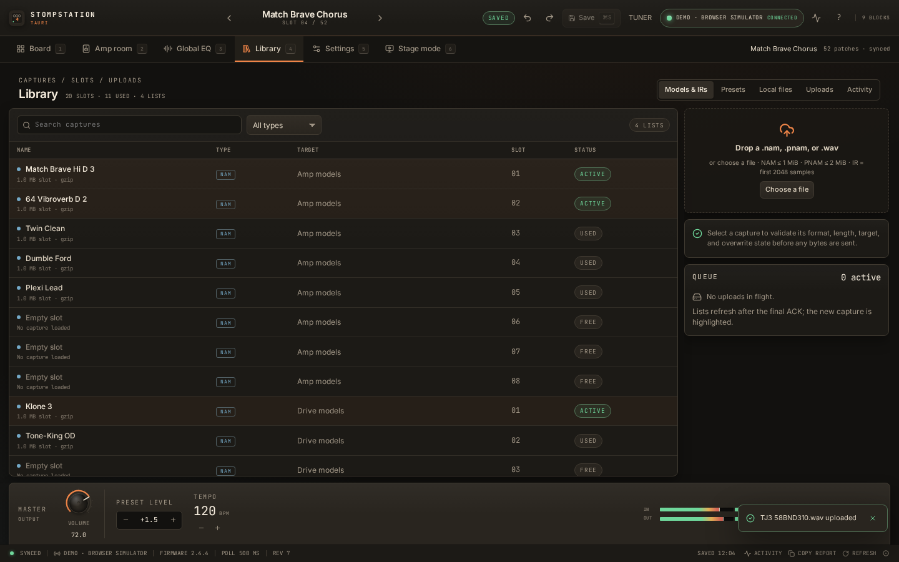
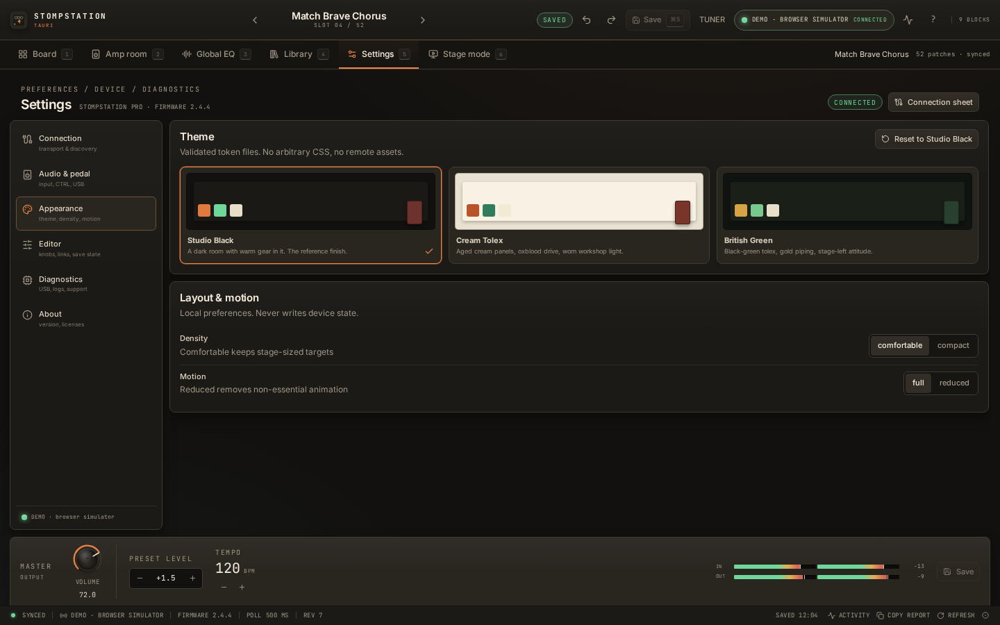
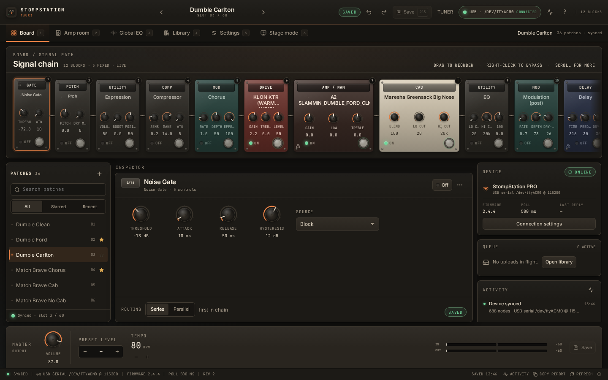
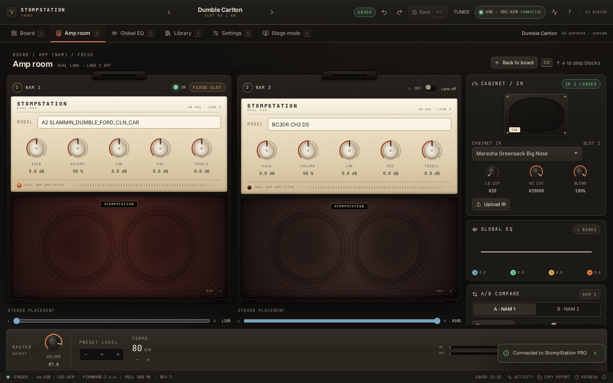
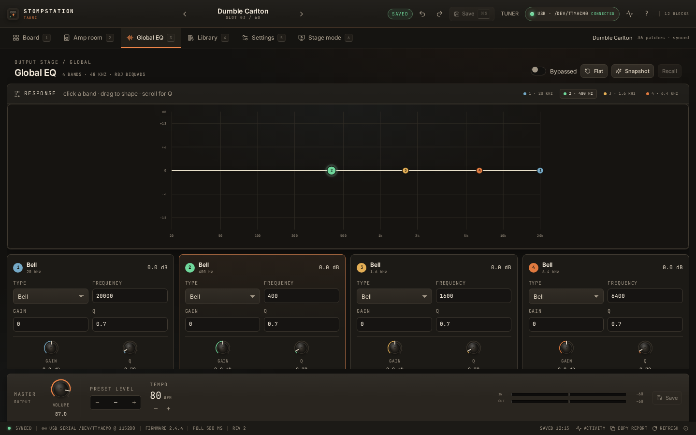
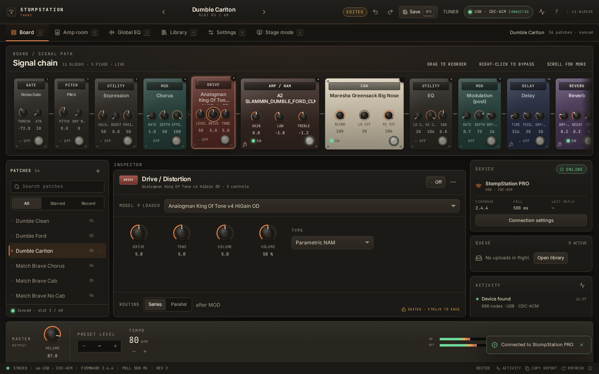

# StompStation

> **Disclaimer:** This is an independent, open-source project. It is not
> affiliated with, endorsed by, or supported by Sonulab. The software may
> contain bugs and is provided “as is”; use it at your own risk, particularly
> when writing to hardware. Review [`docs/DEVICE_SAFETY.md`](docs/DEVICE_SAFETY.md)
> before use.

[](https://github.com/obiwanconobi/ssp-linux-controller/actions/workflows/build.yml)

Pedalboard-first desktop controller for the **Sonulab StompStation PRO** guitar
multi-effects pedal, built with Rust, Tauri, React, and TypeScript. It connects
over Wi-Fi or USB, edits the signal chain and block parameters, uploads NAM,
Parametric NAM (`.pnam`), and IR files, and keeps a live view of the pedal.

The original Python GTK client has moved to [`Legacy/`](Legacy/README.md), where
it remains available as the protocol reference and fallback. This README
describes the primary Tauri application.

The project is deliberately split into two worlds:

- **Rust core** — framing, node cache, router, presets, editor derivation,
  upload codecs, EQ math, transports, simulator, and tests.
- **React + Tauri shell** — a pedalboard-first interface that consumes typed
  view models and never owns a socket.

## Status

| Area | State |
| --- | --- |
| Phase 0 — protocol freeze | Core ported and tested; simulator + hardware fixtures; Python/Rust differential is clean on 2.4.4 and live 2.5.3 |
| Phase 1 — walking skeleton | Tauri commands, USB/TCP transports, browse, writes, presets, chain edits, snapshot mapping, real connect path; the single-owner actor owns polling, reconnect backoff, and monotonic snapshot revisions; reversible gate write/readback/restore passed on hardware; launch discovery is Wi-Fi → USB with an explicit no-device state |
| Phase 2 — design system & board | Design tokens, three themes, component kit, Board, Amp room, Global EQ, Library, Settings, Stage mode, command palette, tuner deck, responsive layouts |
| Phase 3 — deep parity | Uploads are wired end-to-end for NAM, Parametric NAM, and IR only: native picker, device preflight with model/WAV structural validation, capture-list guard, slot selection, ACK progress, cancel-after-current-chunk, and refreshed-list highlighting. Both NAM A1 (flat WaveNet/LSTM weights) and NAM A2 (`SlimmableContainer` submodels) are supported and covered by validator/simulator tests; basic A2, PNAM, and IR uploads are validated on 2.5.3, including the `wav_48000` IR list type. A1 hardware upload, cancel-after-ACK, and overwrite paths remain to be exercised. Preset save, chain add/remove, Wi-Fi discovery, and the Parametric NAM editor are hardware-validated on 2.4.4; 2.5.3 PNAM switches and multi-client Wi-Fi were verified live |
| Live updates | Interim Tauri poller emits snapshots every 500 ms, with a 2 s browse on TCP; uploads pause polling |
| Local library | Sectioned Amps/Drives/IRs browser with NAM/Parametric NAM subsections, recursive `.nam`/`.pnam`/`.wav` folder indexing, preflight, and target/format validation |
| List deletion | Per-row delete in the patch rail and Library lists uses the official zero-fill `dwrite` with confirmation and read-back verification; simulator-tested, hardware delete semantics pending |
| Chain editing | Remove, replace, and clear use one router write per action; add/remove/replace/move/link/clear are covered by the simulator smoke. Clear chain preserves fixed blocks and connectors behind a destructive confirmation. The chain write payload is wrapped as `{"value": ...}` so the firmware accepts it |
| Preset save | Saves the live chain and parameter edits; JSON field order matches the device (`value` before `save`), coalesced writes flush first, and router edits keep the preset dirty until saved |
| Hardware-verified | Gate toggle/restore, preset save with chain + parameter changes, chain add/remove, Wi-Fi auto-discovery, and the PNAM drive editor have been exercised on firmware 2.4.4. Firmware 2.5.3 was checked live for the 694-node tree, PNAM switch controls, simultaneous Wi-Fi clients, and basic NAM A2/PNAM/IR uploads. Chain move/link, EQ writes, upload cancel/overwrite paths, and long idle polling remain open |
| Android | Wi-Fi/TCP-only Tauri app; arm64/x86_64 release APKs build, and the x86_64 release runs in an API 37 emulator. USB serial and Play Store signing are not implemented; see [`docs/ANDROID.md`](docs/ANDROID.md) |
| Local install | `scripts/install-local.sh` installs the release binary, desktop entry, and icons; rerun to update |
| Phase 4–5 — hardening/release | Not started |

The browser build runs against a deterministic demo device so every surface is
inspectable without hardware. The Tauri shell starts disconnected: it scans
mDNS `_http._tcp` for a VoidX device first, then probes USB serial ports, and
opens the connection sheet with a clear error if neither finds a pedal. The
demo board in the Tauri shell is opt-in with `--demo` (or
`STOMPSTATION_DEMO=1`); manual Wi-Fi/TCP and USB remain available in the sheet.

The board is live: parameter and router writes change the pedal immediately.
**Save** persists that live state into the current preset. The Save button stays
disabled until something is dirty; a refresh never clears the dirty flag, and
pending coalesced knob/model writes are flushed before the save command.

Hardware notes, the differential results, and the remaining hardware checklist
live in [`docs/HARDWARE_VALIDATION.md`](docs/HARDWARE_VALIDATION.md). The
step-by-step remaining pass is in
[`docs/REMAINING_VALIDATION.md`](docs/REMAINING_VALIDATION.md). Firmware
2.5.3 verification and the client-side changes it required are in
[`docs/FIRMWARE_2.5.3.md`](docs/FIRMWARE_2.5.3.md).

Before adding a device write or running a hardware upload test, read
[`docs/DEVICE_SAFETY.md`](docs/DEVICE_SAFETY.md). It records the 2026-11-22
soft-brick caused by a synthetic NAM upload, the format/list invariants that
prevent a repeat, and the recovery playbook for update mode.

The official VoidX-Control list-delete behavior is documented in
[`docs/voidx-delete-button-behavior.md`](docs/voidx-delete-button-behavior.md).
The prioritized plan for the remaining work is in
[`docs/REMAINING_WORK.md`](docs/REMAINING_WORK.md).

## Downloads and CI

GitHub Actions builds the desktop app on every push and pull request:

- **Windows x64** — NSIS installer (`.exe`) and MSI (`.msi`)
- **Linux x64** — Debian package (`.deb`) and AppImage
- **macOS x64 (Intel)** — `.dmg` and zipped `.app`
- **macOS arm64 (Apple Silicon)** — `.dmg` and zipped `.app`

The workflow lives in [`.github/workflows/build.yml`](.github/workflows/build.yml).
Each run uploads the installers/packages as downloadable workflow artifacts.
Pushes to `master` publish or update the GitHub Release for the version in
`apps/desktop/src-tauri/tauri.conf.json`, with the installers attached. To cut
a new release, bump that version and push; an explicit `v*` tag can also be
pushed to publish or update that tag's release. CI fails when the workspace
Cargo version, UI package version, or a pushed `v*` tag disagrees with
`tauri.conf.json`.

The Linux AppImage is larger than the Windows bundle because it embeds
GTK/WebKitGTK, while Windows uses the system WebView2 runtime. macOS builds
are ad-hoc signed but not notarized, so Gatekeeper requires right-clicking the
app and choosing **Open** (or removing the quarantine attribute) on first
launch.

## Screenshots

Captured at 1440 × 900. Demo surfaces use the deterministic simulator;
screenshots labelled “hardware” use the real 2.4.4 fixture.

| | |
| --- | --- |
|  |  |
| **Board** — preset rail, full-width chain, focused inspector, pinned master. | **Amp room** — dual NAM lanes, cabinet, EQ preview, A/B compare. |
|  |  |
| **Global EQ** — direct-manipulation curve + four numeric band cards. | **Library** — models, IRs, preflight, and the visible upload queue. |
|  |  |
| **Stage mode** — glanceable preset, bypass tiles, master, tempo, tuner. | **Tuner deck** — note, cents, frequency, reference, input level. |
|  |  |
| **Appearance** — validated theme tokens, density, motion. | **Cream Tolex** — the same layout, a different finish. |
|  |  |
| **Real 2.4.4 hardware** — 12 blocks, 60 patch slots, 36 named patches. | **Real NAM lanes** — lane 2 off, real model names, pan and IR. |
|  |  |
| **Real global EQ** — 0-based device bands normalized to 1–4, bypassed. | **Real capture lists** — 60/10/60/10/50 slots across five lists. |
|  |  |
| **Local files** — recursively indexes a chosen folder and preflights captures. | **Parametric NAM** — the active PNAM loader and model-dependent controls. |

## Workspace

```text
.
├─ .github/workflows/build.yml # Windows + Linux + macOS release builds
├─ Cargo.toml                 # Rust workspace
├─ crates/
│  ├─ stomp-protocol/         # frame parsing, commands, NodeStore, router,
│  │                          # presets, editor derivation, pfloat, labels
│  ├─ stomp-transport/        # Transport trait, serialport, TCP, scripted replay
│  ├─ stomp-device/           # single-owner Device core, view models, uploads
│  ├─ stomp-upload/           # NAM/PNAM/IR codecs + ACK state machine
│  ├─ stomp-eq/               # RBJ biquads + response evaluation at 48 kHz
│  ├─ stomp-sim/              # deterministic fake pedal over TCP
│  └─ stomp-cli/              # probe, dump, fixture, replay, upload, bench
├─ apps/desktop/
│  ├─ src-tauri/              # Tauri 2 app, typed commands, state
│  │  └─ gen/android/         # Tauri Android project (source; build outputs ignored)
│  └─ ui/                     # React 19 + TypeScript + Vite, design system
├─ docs/                      # device safety, remaining work, hardware validation, Android, screenshots
├─ fixtures/
│  └─ snapshots/              # generated snapshot + block editors
├─ Legacy/                    # original Python GTK client and protocol notes
├─ packaging/                 # Linux desktop entry and udev rule
└─ scripts/
   ├─ smoke.sh                # simulator -> core -> assertions
   ├─ build-android.sh        # APK build + zipalign + sign
   ├─ install-local.sh        # desktop release install/update
   └─ dev.sh                  # Vite + Tauri dev shell
```

## Run the UI

```bash
cd apps/desktop/ui
pnpm install
pnpm dev          # http://127.0.0.1:1420
pnpm build        # production bundle (required before the Playwright smokes)
pnpm lint         # TypeScript project check
pnpm test         # unit + mapping tests (Vitest)
pnpm test:ui       # Playwright interaction smoke against the built bundle
pnpm test:startup  # Playwright startup smoke: Wi-Fi/USB failure, --demo, USB success
pnpm test:a11y     # axe WCAG AA scan: three themes, every view and overlay
pnpm test:keyboard # keyboard-only pass: skip link, tabs, dialogs, knobs, shortcuts
pnpm test:states   # focused, pending, conflict, and error state checks
pnpm test:visual   # compare 21 screenshots against committed baselines
pnpm test:visual:update # regenerate the visual baselines
```

The Playwright smokes start their own Vite preview server. Override the default
ports with `UI_SMOKE_PORT=…` / `STARTUP_SMOKE_PORT=…` if they are already in
use.

The browser preview starts on the simulated board. Press `Ctrl/⌘+K` for the
command palette, `1`–`6` for views, `T` for the tuner, and `Space` to bypass the
selected block.

## Test matrix

Run the fast, hardware-free suite from the repository root:

```bash
cargo fmt --all --check
cargo clippy --workspace --all-targets -- -D warnings
cargo test --workspace          # 43 Rust tests
./scripts/smoke.sh              # simulator -> core -> chain/save/preset/upload assertions

cd apps/desktop/ui
pnpm lint
pnpm test                       # 61 Vitest tests
pnpm build
pnpm test:ui                    # interaction smoke
pnpm test:startup               # no-device / --demo / Wi-Fi-or-USB startup smoke
pnpm test:a11y                  # WCAG AA scans in all themes and overlays
pnpm test:keyboard              # keyboard-only pass
pnpm test:states                # focused/pending/conflict/error states
pnpm test:visual                # screenshot baseline comparison
pnpm test:visual:update         # regenerate baselines after an intended UI change
```

Android packaging is checked separately:

```bash
./scripts/build-android.sh aarch64 release
```

The automated suites never write to hardware. Hardware writes are only part of
manual validation and are listed in
[`docs/HARDWARE_VALIDATION.md`](docs/HARDWARE_VALIDATION.md).

### Protocol invariants worth preserving

- Router writes are an object: `write root\app\router:{"value":[[...]]}`.
  A bare matrix is rejected by the firmware and never ACKs.
- Preset saves must serialize `value` **before** `save`:
  `write root\app\preset:{"value":"Name","save":"save"}`. The firmware
  applies fields in order; reversing them reloads the stored preset and
  discards unsaved chain/parameter changes. `serde_json` uses
  `preserve_order` for this reason.
- Editor visibility is type-aware. `model` is the NAM loader, `pmodel` is the
  Parametric NAM loader, and `p1..pN` pfloat controls belong to the active
  PNAM model. The UI must prefer the visible loader, not always `model`.
- Firmware 2.5.3 exposes PNAM switch positions as pfloat nodes whose `vtype`
  style is a JSON array such as `["ON","OFF"]`. The node value is the option
  index normalized to `index / (count - 1)`, not a 0–1 continuous knob.

## Install locally

Install Rust (stable), Node 22+, pnpm, and the Tauri system dependencies first.
On Debian/Ubuntu:

```bash
sudo apt update
sudo apt install -y \
  libwebkit2gtk-4.1-dev libappindicator3-dev librsvg2-dev patchelf \
  libgtk-3-dev libudev-dev libssl-dev libxdo-dev pkg-config
```

`libudev-dev` is required by the Rust `serialport` crate used for USB pedal
access. Then build the production UI, embed it in the release binary, and
install it for the current user:

```bash
./scripts/install-local.sh
```

That installs:

- `~/.local/bin/stompstation`
- `~/.local/share/applications/stompstation.desktop`
- hicolor icons under `~/.local/share/icons/hicolor/`

Launch **StompStation** from the application menu or run
`~/.local/bin/stompstation`. It searches Wi-Fi first, then USB. Run
`~/.local/bin/stompstation --demo` to open the simulator board without hardware.
Re-run the same script after any change to rebuild and replace the installed
app. The release build uses Tauri's `custom-protocol` feature, so it loads the
embedded UI with no Vite server.

## Android APK

The Android build uses the same Rust core and React UI. It is **Wi-Fi/TCP only**:
Android has no usable USB CDC-ACM path here, so the mobile connection sheet
hides USB and defaults to Wi-Fi/manual TCP.

```bash
export JAVA_HOME=/opt/android-studio/jbr
export ANDROID_HOME="$HOME/Android/Sdk"
export NDK_HOME="$ANDROID_HOME/ndk/28.2.13676358"

./scripts/build-android.sh aarch64 release   # phone
./scripts/build-android.sh x86_64 release   # emulator
```

Outputs land in `dist/android/` (gitignored). Release APKs are signed
with the local Android debug key for sideloading; set `STOMPSTATION_KEYSTORE`
and related variables for a real upload key. The generated project lives in
`apps/desktop/src-tauri/gen/android`, and `MainActivity` holds a Wi-Fi
`MulticastLock` for mDNS.

Tested with a Pixel 10 Pro API 37 x86_64 emulator over `adb reverse` to the
simulator. A physical phone has not been tested yet. Full prerequisites,
signing, install, and troubleshooting notes are in
[`docs/ANDROID.md`](docs/ANDROID.md).

## Run the desktop shell in development

The shortest route (starts Vite and the Tauri dev window, from the repository root):

```bash
./scripts/dev.sh          # auto-discover Wi-Fi, then USB
./scripts/dev.sh --demo   # force the demo board, no hardware search
./scripts/dev.sh --sim    # also start the simulator on 127.0.0.1:45678
```

The connection pill opens the transport sheet: USB `/dev/ttyACM0` for the
pedal, or Network `127.0.0.1:45678` for the simulator.

With the Tauri CLI instead:

```bash
# one-time: install the Tauri CLI
cargo install tauri-cli --version '^2'

cd apps/desktop/ui
pnpm install
cd ..
cargo tauri dev          # starts Vite on 127.0.0.1:1420 automatically
```

Without the Tauri CLI, start the frontend yourself:

```bash
# terminal 1, from the repository root
cd apps/desktop/ui && pnpm dev

# terminal 2, from the repository root
cargo run -p stompstation-desktop
```

A debug `cargo run` uses the Vite dev URL. For a production-like run:

```bash
cd apps/desktop/ui && pnpm build
cd ../../..
cargo build --release -p stompstation-desktop
./target/release/stompstation-desktop
```

In the connection sheet:

- **USB** — pick `/dev/ttyACM0` (or the enumerated port).
- **Network** — enter `127.0.0.1:45678` to talk to the bundled simulator, or the
   pedal's `host:port`.
- **Use simulator** — in the browser preview, or in Tauri when launched with
  `--demo` / `STOMPSTATION_DEMO=1`.

## Troubleshooting

- **No device found on launch.** The app tries mDNS first, then USB. Check that
  the pedal and computer are on the same network, or open the connection sheet
  and pick the USB port. `/dev/ttyACM0` needs the udev rule in
  `packaging/linux/70-stompstation.rules` if access is denied.
- **Wi-Fi connects but commands time out.** Firmware 2.5.3 allows several
  simultaneous network readers, but writes are not coordinated between clients.
  On older firmware close other clients before reconnecting; USB serial still
  supports one client at a time.
- **Save is disabled.** It enables only when the preset is dirty. Chain edits,
  bypasses, model changes, and knob changes all mark it dirty; a board refresh
  does not clear it.
- **Parametric NAM looks empty.** A PNAM block needs an active `pmodel`. The app
  selects the first available model when switching type; changing the model
  rebrowses the editor so `p1..pN` labels and ranges appear.
- **Remove/replace is disabled.** Fixed slots (amp, delay, reverb on 2.4.4) are
  protected. Replacement also requires at least one unused block.
- **Simulator connection.** Start `cargo run -p stomp-sim -- --port 45678` and
  connect to `127.0.0.1:45678` in the Network tab, or use `--demo` for the
  in-process browser board.

## Run the core + simulator

```bash
# start the fake device (one per command is fine)
cargo run -p stomp-sim -- --port 45678

# another terminal: snapshot, toggle a block, load a preset, upload
cargo run -p stomp-cli --bin stomp -- dump tcp:127.0.0.1:45678
cargo run -p stomp-cli --bin stomp -- set-block tcp:127.0.0.1:45678 'root\app\amp' off
cargo run -p stomp-cli --bin stomp -- set-control tcp:127.0.0.1:45678 \
  'root\app\drive\gain' 2.5
cargo run -p stomp-cli --bin stomp -- editor tcp:127.0.0.1:45678 'root\app\drive'
cargo run -p stomp-cli --bin stomp -- remove-block tcp:127.0.0.1:45678 0 2
cargo run -p stomp-cli --bin stomp -- add-block tcp:127.0.0.1:45678 0 2 'root\app\pitch'
cargo run -p stomp-cli --bin stomp -- replace-block tcp:127.0.0.1:45678 0 0 'root\app\chorus'
cargo run -p stomp-cli --bin stomp -- preset tcp:127.0.0.1:45678 'Dumble Clean'
cargo run -p stomp-cli --bin stomp -- save-preset tcp:127.0.0.1:45678
cargo run -p stomp-cli --bin stomp -- fixture tcp:127.0.0.1:45678 \
  fixtures/snapshots/simulator-2.4.4.json

# the complete simulator smoke
./scripts/smoke.sh
```

`stomp-cli` also supports `move-block <addr> <from-row> <from-col> <to-row>
<to-col>`, `upload <addr> nam|pnam|ir <file> <slot|-> <target>`, and
`replay <fixture.json>`. `fixture` and `editor` are read-only.

## What is ported

- `<command>\r\n\0` framing, NUL and idle-timeout responses, persistent RX
  buffer, first-colon response split, token detection.
- `browse root` replacement snapshots, `read root` deltas, unknown-field
  preservation, double-escaped path normalization.
- Router discovery, 2-D and flat matrices, link markers, fixed positions,
  add/remove/move/link edits, ancestor enabling.
- Preset discovery from `plist` refs, list fallbacks, 63-byte name rules,
  128-byte padded rename chunks.
- Preset save with firmware-sensitive field order (`value` before `save`),
  coalesced-write flush, and a dirty flag that survives board refreshes.
- Block editor derivation: nested folders, modules, tempo-sync groups, model/IR
  selectors, pfloat metadata and display ranges, type-aware NAM/PNAM visibility,
  active `model`/`pmodel` loader selection, dual `nam2`/`ir2` groups.
- NAM/PNAM 1/2 MiB padding + gzip level 6, 128-byte name chunk, 2048-character
  final marker, full-tail marker edge case, IR 2048-sample float32 conversion,
  ACK slot/chunk validation and polling-pause semantics.
- Four-band RBJ EQ response at 48 kHz.
- USB CDC-ACM, TCP, and scripted transports; serial port enumeration.
- Shell knob auto-assignment (priority, aliases, three-knob cap, no phantom
  knobs), theme tokens, and the view models the UI consumes.

## Known gaps / next steps

1. **Revisioned patch stream.** The single-owner actor, monotonic revisions,
   reconnect backoff, and external-change conflict UX are implemented on full
   snapshots. A delta/patch stream remains an optimization for very large
   boards, not a correctness blocker.
2. **Upload hardware validation.** The picker → preflight → `begin_upload`
   path, ACK progress, cancel boundary, refreshed target list, and new-slot
   highlight are wired. A1, cancel-after-ACK, overwrite, and audio readback
   still need a hardware pass.
3. **Settings discovery panel.** Launch/manual discovery works (Wi-Fi → USB,
   mDNS list), and Settings now re-scans real serial/mDNS results, shows the
   active transport/address, and accepts a manual TCP target.
4. **Device undo hardware pass.** Device edits now record typed operations and
   replay inverse control/router writes; validate undo/redo and reconnect
   history clearing on real firmware.
5. **Hardware validation.** Uploads still need a scratch-slot pass; move/link,
   EQ writes, external-change handling, and unplug/replug remain open. Tuner
   open/close passed on 2.5.3 with v0.4.2. Ten-minute idle polling passed
   read-only. See the hardware checklist.
6. **Android release.** Physical-phone Wi-Fi/mDNS validation, USB-OTG serial
   (optional), Play Store AAB/upload-key signing, tablet layout, and
   reconnect-on-resume remain open.
7. **Packaging.** GitHub Actions builds Windows NSIS/MSI and Linux
   deb/AppImage artifacts. macOS signing/notarization, an updater, and
   crash-report opt-in remain.
8. **Accessibility audit.** Knobs expose the ARIA slider contract, LEDs have
   text labels, graphs have numeric cards, and focus order follows the chain.
   All three themes pass the WCAG AA axe scan, the keyboard-only pass covers
   every view and overlay, and focused/pending/conflict/error states are
   checked automatically.

## Design notes

- Default theme **Studio Black**; **Cream Tolex** and **British Green** are
  token-only variants. Themes are validated token files in the real app; this
  build ships the three built-ins as CSS token sets.
- DOM + CSS + SVG only. No canvas. Meters use a small `requestAnimationFrame`
  loop outside React state; knobs write local state immediately and coalesce
  device writes at 50 ms in the typed IPC client.
- Every fixed slot has a lock; every LED has ON/OFF text; every EQ graph has
  four numeric band cards; every pointer gesture has a keyboard path.
- `prefers-reduced-motion` and the Appearance → Motion switch remove
  non-essential animation.

## Legacy Python client

The original GTK4/libadwaita client is preserved under [`Legacy/`](Legacy/README.md):

- `Legacy/stomp.py` — protocol client and library
- `Legacy/stomp_ui.py` — modern GTK4 UI
- `Legacy/stomp_ui_legacy.py` — older debug UI
- `Legacy/tests/` — protocol, preset, editor, and upload tests
- `Legacy/docs/` — older protocol notes and reverse-engineering reports

Run it from the legacy folder:

```bash
cd Legacy
python3 stomp.py

# protocol tests
python3 -m unittest discover -s tests -v
```

## Source of truth

- Python protocol: `Legacy/stomp.py`
- Python UI behaviour inventory: `Legacy/stomp_ui.py`, `Legacy/stomp_ui_legacy.py`
- Tests to mirror: `Legacy/tests/test_stomp.py`
- Protocol notes: `Legacy/docs/stompstation-pro-protocol.md`
- Design dossier: `Legacy/docs/tauri-rebuild-report.html`

Nothing in the desktop app requires Python at runtime. The Python client is kept
as a reference implementation and a fallback during the port.
