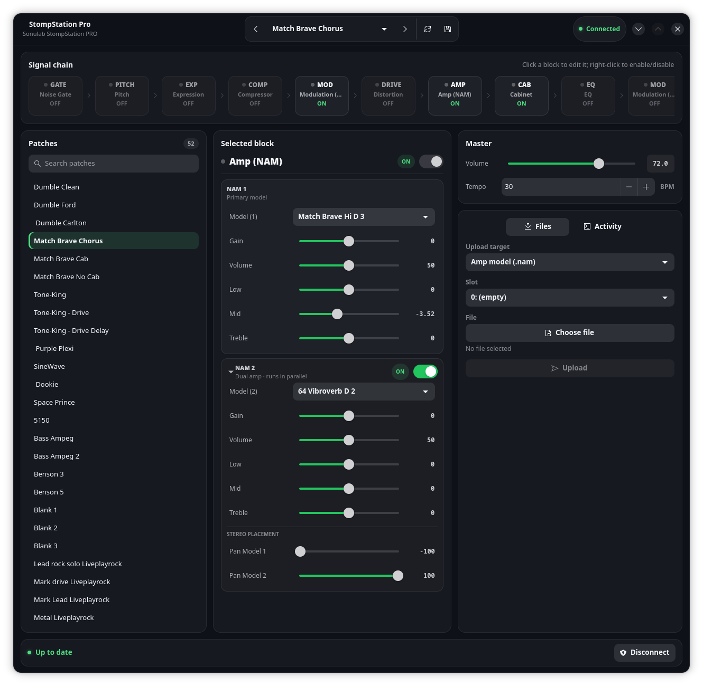

# StompStation Pro Control

An unofficial, Linux client for the **Sonulab StompStation PRO** guitar
multi-effects pedal. It connects over USB or the network and gives you a
modern desktop UI for:

- changing patches,
- enabling/disabling and editing the blocks in the signal chain,
- changing drive/amp models and cabinet IRs,
- uploading NAM amp/drive models and IR WAV files.

It is built from the reverse-engineered VoidX node protocol — not from an
official SDK — so use it at your own risk.



## Install

This is a Linux desktop application. You do not need to be a programmer;
copy and paste the commands below.

### 1. Install the required packages

**Debian / Ubuntu**

```bash
sudo apt update
sudo apt install git python3 python3-gi gir1.2-gtk-4.0 gir1.2-adw-1 python3-serial
```

**Arch / CachyOS**

```bash
sudo pacman -S --needed git python-gobject gtk4 libadwaita python-pyserial
```

On other distributions, install Python 3.10+, GTK 4, libadwaita, PyGObject,
and `pyserial` using your package manager.

### 2. Download the app

```bash
git clone https://github.com/obiwanconobi/ssp-linux-controller.git
cd ssp-linux-controller
```

You can also download the repository as a ZIP from GitHub, extract it, and
open a terminal in that folder.

### 3. Connect the pedal

- **Network (default):** connect the pedal and computer to the same Wi-Fi or
  local network.
- **USB:** connect the pedal with a data-capable USB cable. If USB does not
  appear, allow your user to access the serial port:
  - Debian / Ubuntu: `sudo usermod -aG dialout "$USER"`
  - Arch / CachyOS: `sudo usermod -aG uucp "$USER"`

  Log out and back in after changing the group.

Close any other app already connected to the pedal, including the official
VoidX-Control app, before starting this one.

### 4. Start the app

```bash
python3 stomp.py
```

In the bottom-right corner, select your pedal and click **Connect**. Network
discovery is selected by default. If the pedal is not discovered, choose
**Manual TCP** and enter its address (for example `192.168.1.97:8080`), or run
`python3 stomp.py --diagnose` for USB diagnostics.

## Features

- **USB serial or network** connection:
  - auto-detected CDC-ACM serial ports (`/dev/ttyACM*`),
  - TCP devices discovered with mDNS (`_http._tcp`, `id` containing `voidx`),
  - manual `host:port` entry.
- Reads the full node tree with `browse root`, then polls `read root` deltas.
- Discovers the patch list, current patch, signal-chain router, block states,
  master volume, and tempo from the device.
- **Signal chain as a horizontal row of colour-coded blocks** — bypassed
  blocks are dimmed; click a block to select and edit it, or right-click it
  to enable/disable it.
- Selected-block editor: enable switch plus editable parameters (floats as
  sliders, enums and model/IR lists as dropdowns, numbers as spin buttons,
  text as entries).
- **Dual-NAM Amp editing** on firmware 2.0.8+: separate NAM 1 and NAM 2 cards,
  independent model and tone controls, stereo pan per model, and a collapsible
  second-model section.
- **Dual IR editing**: separate IR 1 and IR 2 cards, independent filter and
  blend controls, per-IR level and pan, and a collapsible second-IR section.
- Patch list with single-click loading, previous/next, reload, and save.
- Master volume and tempo controls.
- NAM and IR upload with slot selection, overwrite confirmation, and progress.
- Activity log.
- Detects patch/chain changes made on the device itself and re-syncs; the
  selected block's parameters, model, and IR also live-update from the device.

Two interfaces are included:

- `stomp_ui.py` — the modern GTK4/libadwaita interface (default).
- `stomp_ui_legacy.py` — the earlier, simpler interface, kept for debugging.

## Advanced running options

Preselect a transport:

```bash
python3 stomp.py --serial /dev/ttyACM0
python3 stomp.py --tcp 192.168.1.97:8080
python3 stomp.py --legacy        # launch the legacy/debug UI
python3 stomp.py --diagnose      # print USB/kernel diagnosis without the UI
```

The UI defaults to network (mDNS) discovery; use the transport dropdown in
the bottom-right corner to switch to USB serial or a manual TCP address.

## Tests

```bash
python3 -m unittest discover -s tests -v
```

The tests use an in-memory fake device and cover protocol parsing,
preset/router discovery, block-parameter extraction, and NAM/IR upload
framing.

## Repository layout

```
stomp.py               Protocol client / library + entry point
stomp_ui.py            Modern GTK4/libadwaita UI
stomp_ui_legacy.py     Legacy GTK4 UI (debugging backup)
tests/                 Unit tests
docs/
  PROTOCOL.md          Older USB-capture protocol notes
  stompstation-pro-protocol.md  Static reverse-engineering notes (VoidX node protocol)
  PROJECT_SUMMARY.md   Development summary / status
  screenshot.png       UI screenshot
dev/                   Reverse-engineering artifacts (captures, logs, firmware,
                       sample NAM/IR, the Frida sniff script) — gitignored
```

## Protocol summary

Commands are line-oriented text terminated with `\r\n\0`:

```text
read root                      # poll (delta)
browse root                    # full node-tree snapshot
write <path>:{"value":<v>}     # set a value
write <block>\on_off:{"value":"ON"|"OFF"}
dwrite <list>:{"index":N,"chunk":M,"value":"<hex>"}   # chunked upload
```

A patch is the `value` of the `preset` node; its `ref` points at the patch
list. The signal chain is a `router` node whose non-empty cells are block
paths. See `docs/stompstation-pro-protocol.md` for details.

## Known limitations

- Password/token authentication is not implemented (the proprietary hash is
  not documented).
- Chain editing (add/remove/reorder blocks) is not exposed in the UI; block
  on/off and parameter editing are.
- Patch import/export bundles are not implemented.
- IR conversion uses the first channel and first 2048 samples, with no
  resampling (matching the official app's observed behaviour).
- Running this client and the official app at the same time makes them steal
  each other's `read root` deltas.

## Disclaimer

This project is not affiliated with or endorsed by Sonulab. It is the result
of independent reverse engineering of the pedal's network/serial protocol.
