# Screenshots

Captured at 1440 × 900. Demo surfaces use the deterministic simulator;
screenshots labelled “hardware” use the real 2.4.4 fixture.

## Desktop interface

| | |
| --- | --- |
| 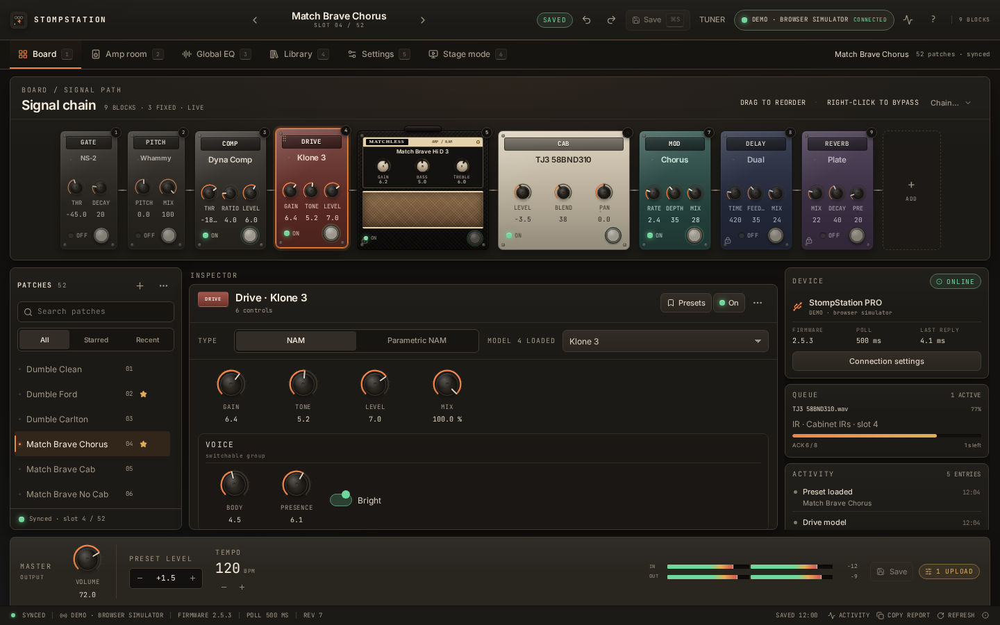 | 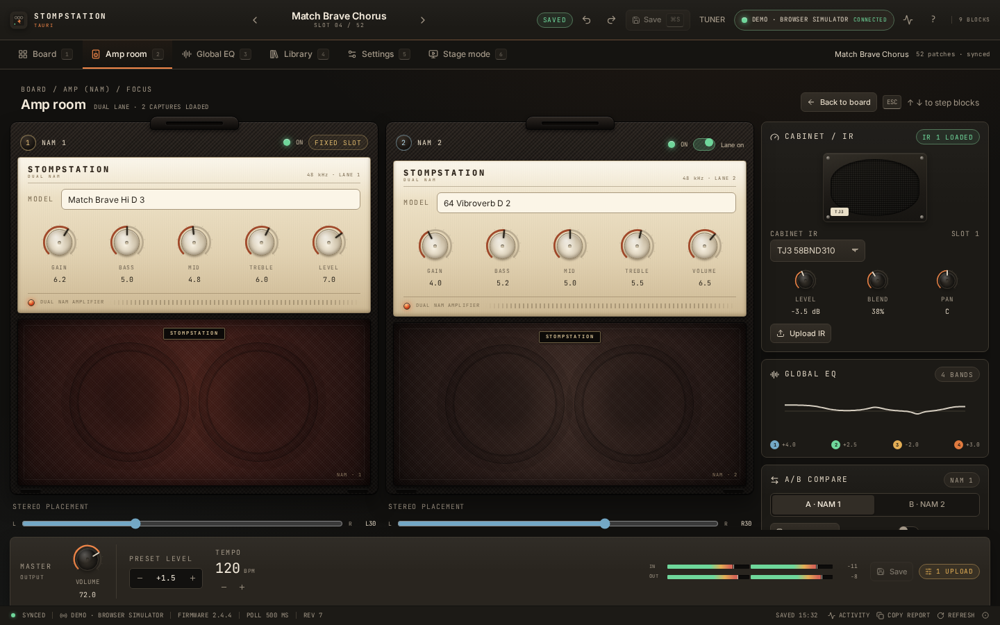 |
| **Board** — preset rail, full-width chain, focused inspector, pinned master. | **Amp room** — dual NAM lanes, cabinet, EQ preview, A/B compare. |
| 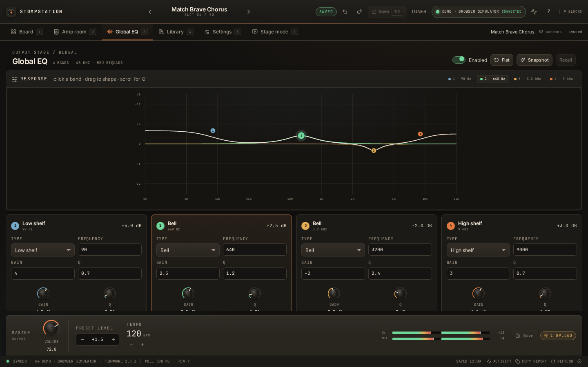 | 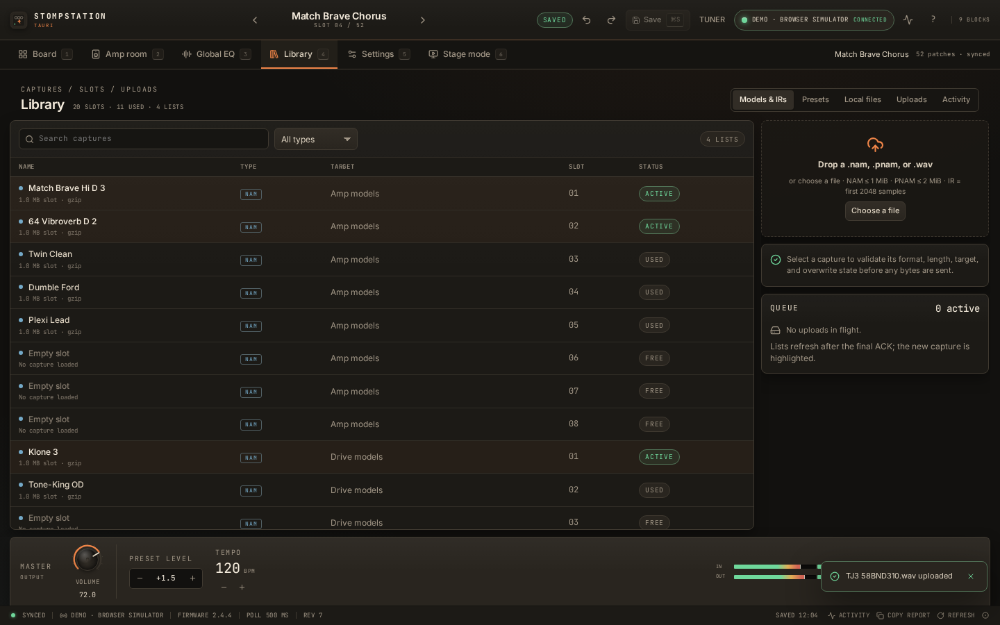 |
| **Global EQ** — direct-manipulation curve + four numeric band cards. | **Library** — models, IRs, preflight, and the visible upload queue. |
| 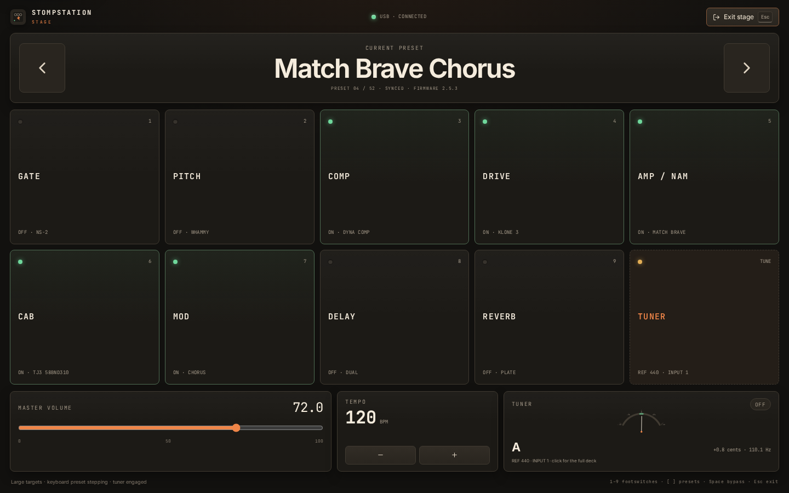 | 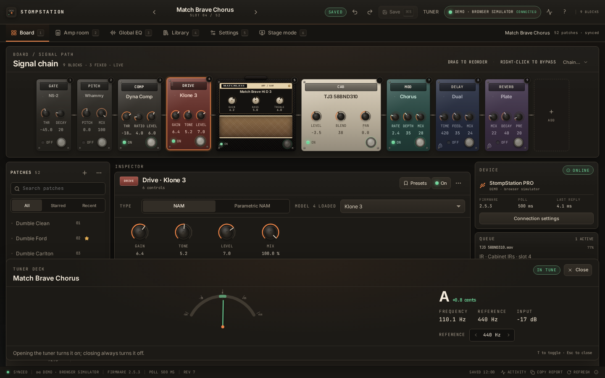 |
| **Stage mode** — glanceable preset, bypass tiles, master, tempo, tuner. | **Tuner deck** — note, cents, frequency, reference, input level. |
| 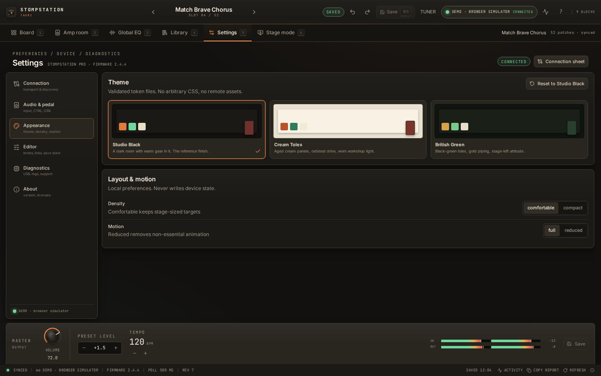 | 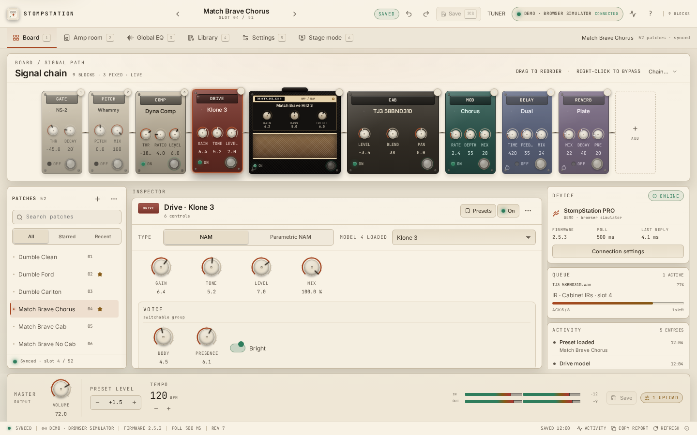 |
| **Appearance** — validated theme tokens, density, motion. | **Cream Tolex** — the same layout, a different finish. |

## More surfaces

| | |
| --- | --- |
| 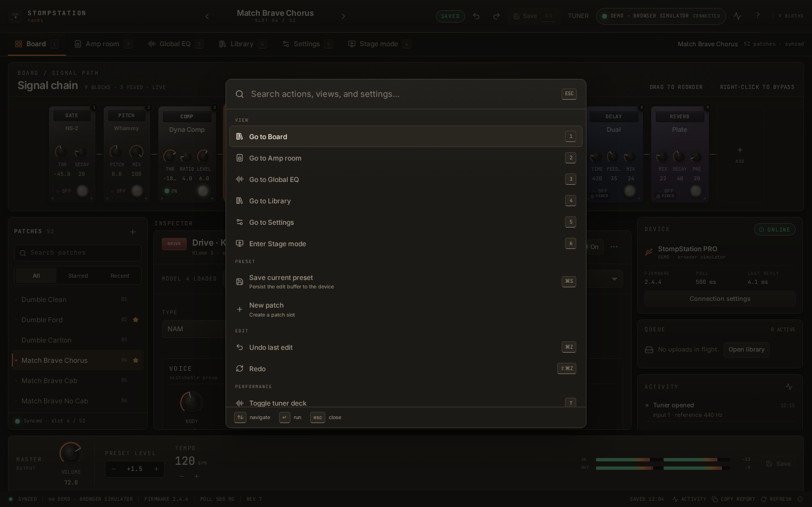 | 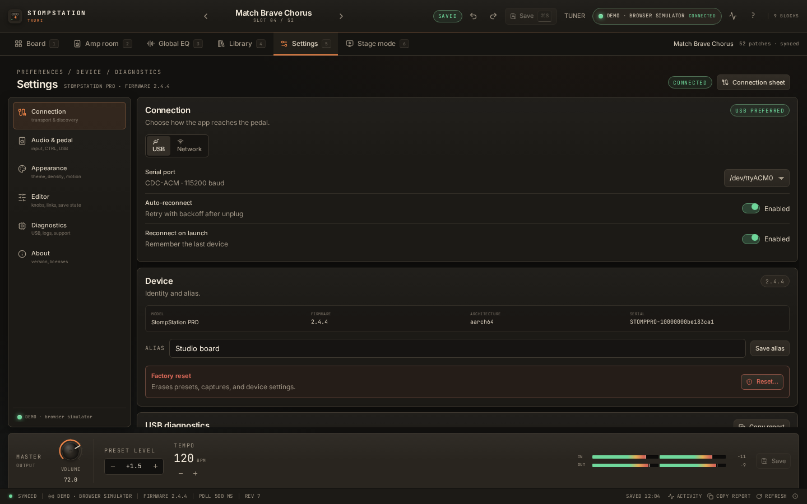 |
| **Command palette** — `Ctrl/⌘+K` navigation and actions. | **Settings** — transport, audio, appearance, and about. |
| 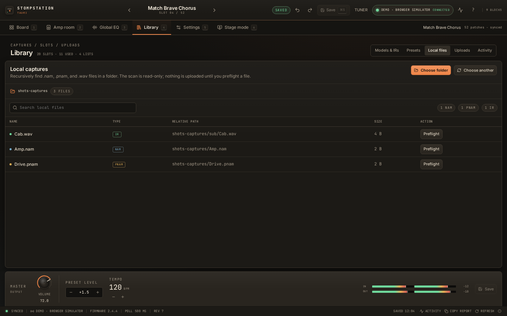 | 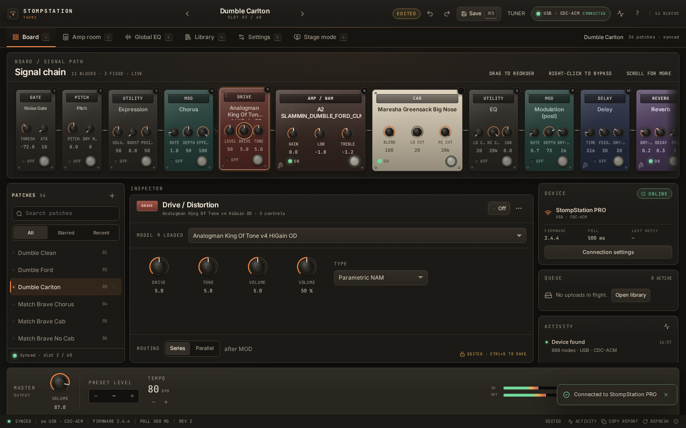 |
| **Local files** — recursively indexes a chosen folder and preflights captures. | **Parametric NAM** — the active PNAM loader and model-dependent controls. |

## Real 2.4.4 hardware

| | |
| --- | --- |
| 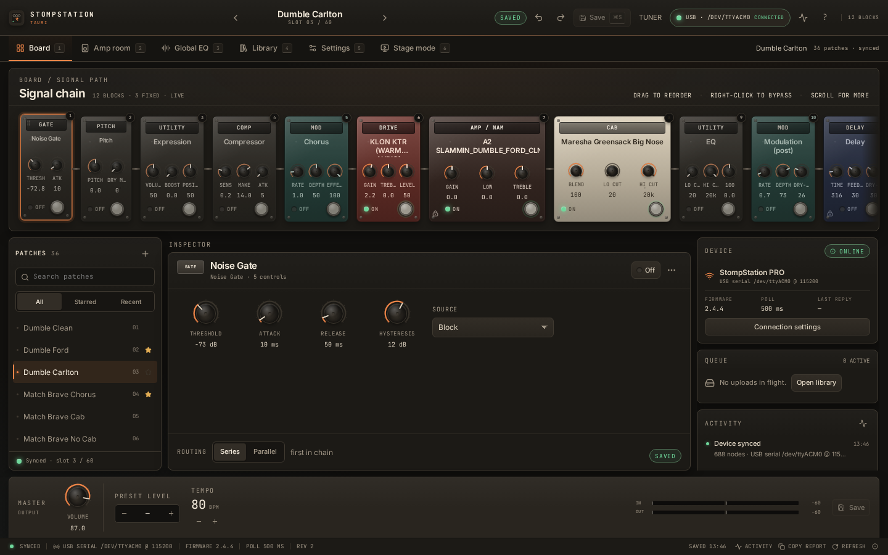 | 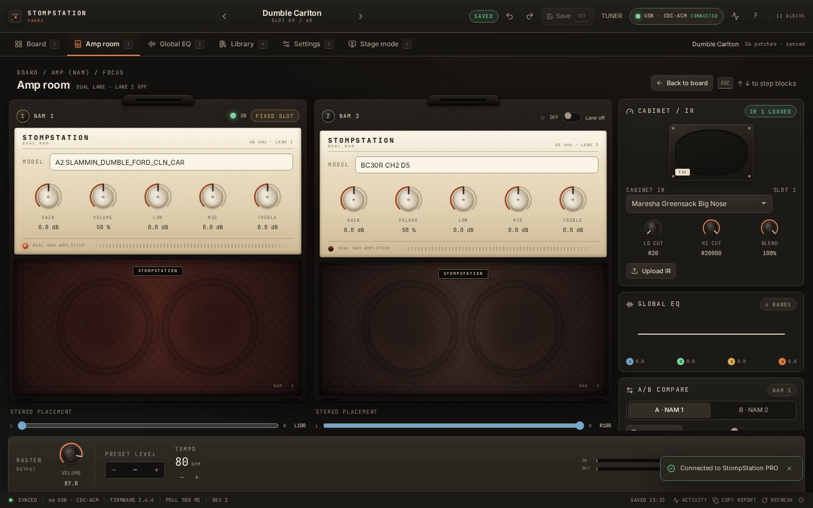 |
| **Real 2.4.4 hardware** — 12 blocks, 60 patch slots, 36 named patches. | **Real NAM lanes** — lane 2 off, real model names, pan and IR. |
| 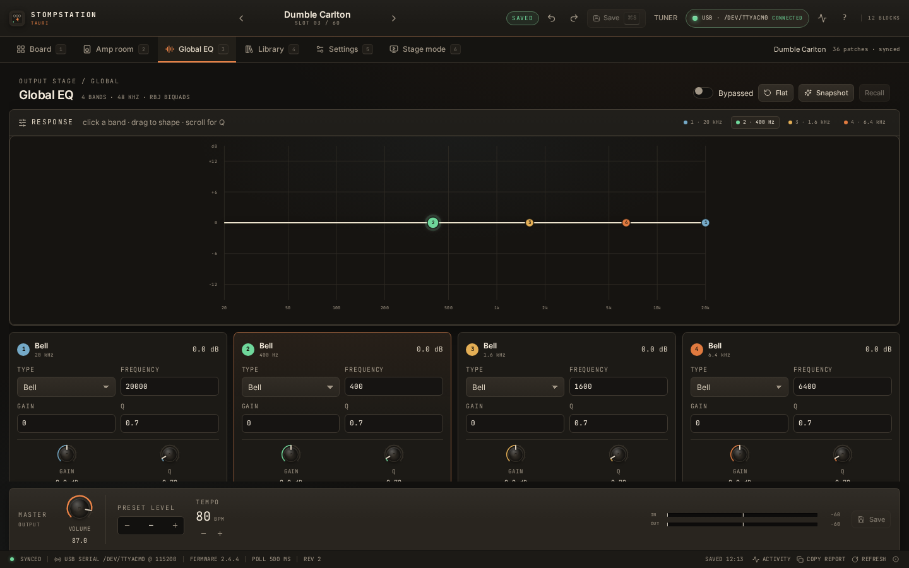 | 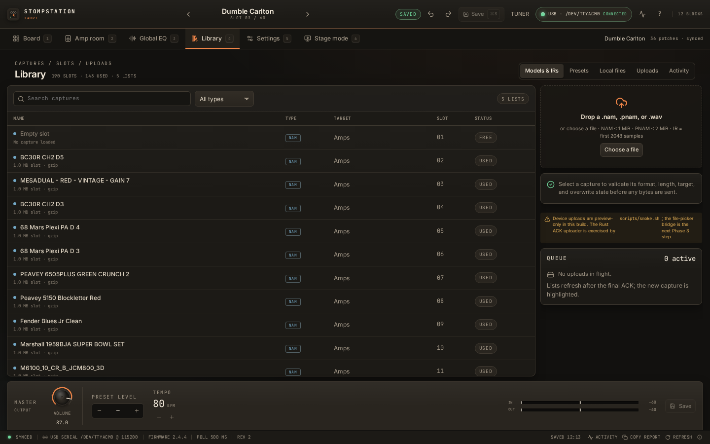 |
| **Real global EQ** — 0-based device bands normalized to 1–4, bypassed. | **Real capture lists** — 60/10/60/10/50 slots across five lists. |
